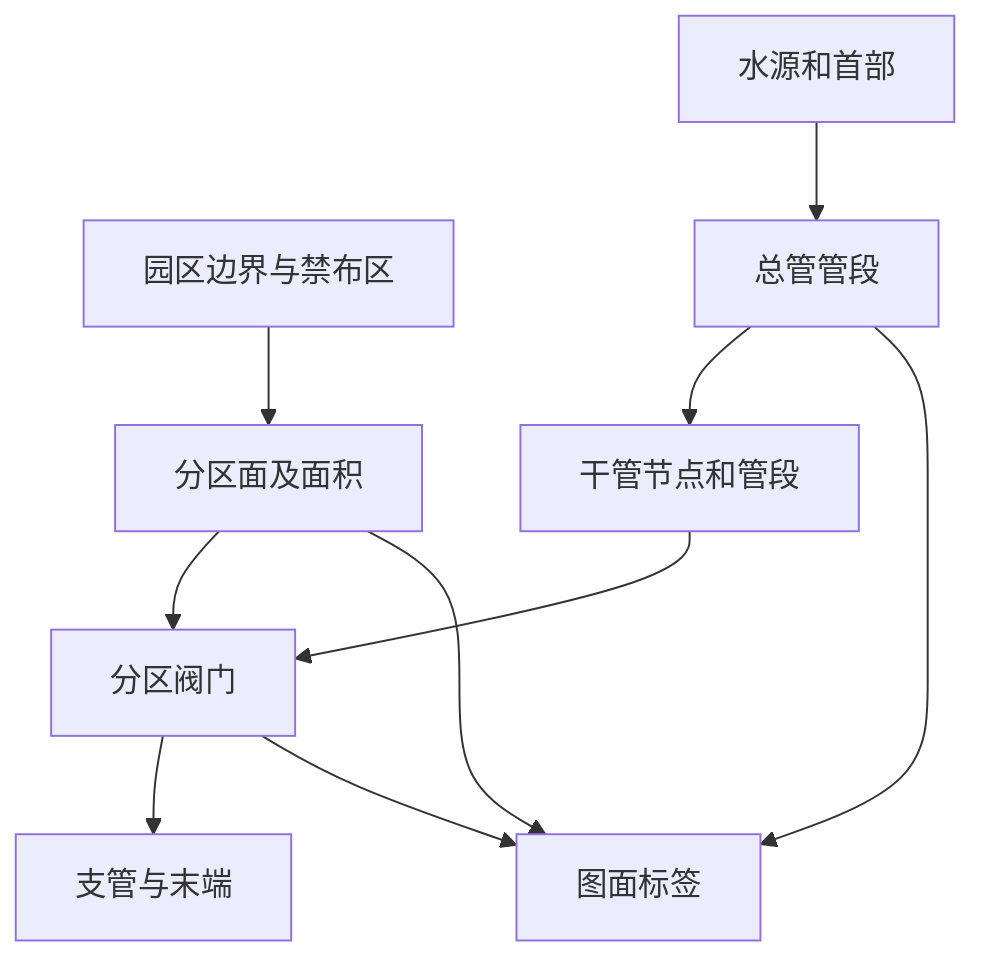
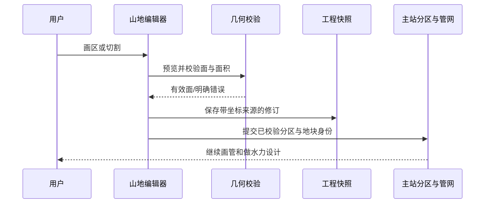

# 山地槟榔园灌溉规划图复刻任务书（讨论稿）

日期：2026-11-04  
状态：方案研究，未批准实施  
参照图：`C:\Users\AHS\Desktop\南坤槟榔规划图 - 十亩一个区-模型.pdf`（单页 A4 横向 CAD 输出）  
目标工具：润野灌溉设计工具

## 1. 目标与边界

让用户从航测正射图或在线卫星底图出发，在真实坐标中快速描出山地槟榔园边界、约 10 亩的灌溉小区、道路、水源、干管与支管、阀门及其他设备，并生成一张可编辑、可保存、可导出、带图例的总平面图。图纸表达应接近参照 PDF；工程计算只能使用有来源且已校验的几何与参数。图面相似与水力设计正确分别验收。

本阶段先确定产品与数据方案。**不修改现有大田矩形网格引擎，不把图上的线色直接当成可计算水力网络，不自动声称已达到施工深度。**

## 2. 参照图纸观察与复刻清单

参照图以实景航测拼图为底，呈狭长且弯曲的山地园区；中央有道路、塘水与建筑物，图面写有“屯昌南坤槟榔基地365亩”。上图可见“#分区1”“#分区2”的小区编号，边界是贴合地形和道路的不规则曲线，管线、阀门、水源及图例使用不同色彩和线型。图中文字、线型与符号可作为**视觉样例**；精确数量、管径、材质、标高和流向应从原 CAD 或现场资料核实，不从低分辨率 PDF 猜读。

| 图面元素 | 复刻能力 | 数据权威 |
|---|---|---|
| 航测或卫星底图 | 导入、定位、透明度、缩放、打印 | 带坐标底图或经校准的图像 |
| 园区、道路、水体与禁布区 | 描绘独立图层，供分区与布管参考 | 用户编辑的真实几何 |
| 不规则小区与编号 | 手绘闭合面或切割生成，显示亩数与编号 | 分区多边形 |
| 水源、过滤器、泵站、阀门等 | 设备插入、移动、属性与图例 | 独立设备对象 |
| 总管、干管、支管 | 沿道路或等高线手绘折线、吸附连接 | 拓扑管段与节点 |
| 管径、压力等级、流量 | 根据设计输入计算并由人确认 | 参数与计算结果，附来源 |
| 图例、标题、比例、北针 | 自动生成且可局部编辑 | 图面配置与模型摘要 |

### 图 A：从底图到工程图的工作流

## 3. 先做什么，后做什么

### 第一期：可用的山地图面

1. 导入带坐标的正射图、GeoTIFF/世界文件或用户校准的普通图片；显示坐标基准、精度和底图来源。普通截图若没有足够校准点，允许仅作示意，不进入工程面积计算。
2. 描绘园区、道路、水体、建筑及禁布区，图层可见性与锁定相互独立。
3. 用“画小区边界”描闭合面；支持边界吸附、共享边、编号、面积和撤销。可用道路/水体为自然边界，禁止把禁布区计入灌溉面积。
4. 提供“切一刀”快捷工具：在单个有效小区上画边界到边界的简单折线，生成两块有效面。多点、凹面和多交点交给可靠几何裁切库或已验证的平面图构造算法；不采用逐段半平面交集冒充折线切割。
5. 每次提交后核算：子区并集与原区一致、内部不重叠、面积差在数值容差内；失败不写入。

### 第二期：灌溉网络与施工表达

1. 插入水源、过滤器、泵站、阀门；沿道路或人工指定路线手绘总管、干管、支管，节点吸附后建立真正的拓扑连接。
2. 每个小区绑定阀门与供水支路；网络检查给出断点、孤岛、重复连接和无水源路径。
3. 输入种植密度、滴头或喷头、轮灌方式、坡度与高程、设计流速和工作压力。计算每个小区及轮灌组需求，再逐段反推建议管径、速度和扬程；人工覆盖需保留原因与来源。
4. 图面按对象类型自动取线色、线型、符号、编号和文字位置；允许局部移位以避让航测底图。

### 第三期：图纸交付

1. 输出 A3/A1 等可选纸张与比例的 PDF；标题栏、北针、比例尺、图例、分区表、设备表及版本号从模型生成。
2. 输出分层 DXF，保留管线、设备、分区、道路、文字的独立图层。底图按受支持方式嵌入或附外部引用，并在导出前告知区别。
3. 工程快照可保存、恢复、撤销；再次打开后分区面积、设备归属、管路连接及标注位置一致。

### 图 B：分区与管网数据的分层

## 4. 手绘分区交互细则

- 默认目标 10 亩，可逐区修改；显示实际亩数、与目标的差值及百分比。±5% 显示“达标”只是提示，**不偷偷移动分割线**。若要精确达到目标，另设“按目标面积微调”命令，在预览中求出可行的位置并由用户确认。
- 优先支持“闭合面描绘”，因为参照图的小区边界往往由道路、山脊、水体和已有相邻区共同决定，未必能用一条贯穿线表示。
- 切割模式中，首尾必须落在同一待切面的边界；中间点可自由弯折。悬空端、重复线、自交、沿边重合、切出碎片或多个不连通子面时提示具体原因；只在能形成明确两块时提交。
- 吸附按屏幕像素控制交互命中，落地时写真实米制坐标；显示吸附对象与拟落点。共享边只存一份权威几何或保持拓扑关联，修改后同步相邻区。
- 锁定表示禁止改变分区几何。解锁后可移动顶点或整体移动分割线，但必须重新计算面积；“平移后面积必不变”在固定园区边界内通常不成立。
- 连续分区可先选剩余面再切；每一步都支持撤销、重做、重命名、合并与删除。图面未完成时可保存草稿，草稿不得冒充已校核分区。

## 5. 几何与精度原则

1. **坐标统一。** `terrain` 现用平面米坐标、SVG 显示时才翻转 Y；经纬度度值不能直接算面积。导入数据须记录坐标系、单位、变换与原始文件。底图若只有像素坐标，先校准再计算。
2. **面表示。** 小区需支持凹多边形；道路、水体或空洞需要明确作为扣除面，不能仅在图上盖白色层。可能出现多部件面时明确拆分规则。
3. **有效性。** 环无自交、边长不低于容差、方向与闭合规范一致；共享边与相交点应归一化，避免视觉重合但拓扑断开。
4. **切割。** 采用成熟多边形布尔运算或经独立验证的平面图算法，对折线与边界求交、节点化、建立面并过滤外部面。返回一个或多个真实面，业务层只接收符合本次“两块切分”条件的结果。不可把每段半平面裁剪的交集称为任意折线分割。
5. **数值容差。** 在工程坐标量级下制定统一米制几何容差和相对面积容差；显示亩数四舍五入，守恒检查用未舍入平方米。参考例：`|A原−ΣA子| ≤ max(0.01 m², A原×1e−6)`，实施时结合坐标范围和库精度验证后定稿。
6. **真实坡面。** 平面亩数与坡面面积分别标明；管线长度按实测平面路径计算，若用三维长度需有高程数据。不能用底图纹理推断高程或扬程。

## 6. 与现有代码的接入设计（开工前再核对最终源码）

当前 `terrain/terrain-core.js` 负责地形坐标、面积与持久化，`terrain/terrain-ui.js` 同时服务独立地形页和主页入口；`sendHome()` 目前回传的是地块与高程轮廓资料。`loadState/saveState` 以字段白名单存储，新增手绘成果时必须同时补读写、版本迁移与恢复校验。图纸和可计算管网已有主站规范绘图模型、地块库、总管、分区与管路及水力链路；把复杂分区做成独立地形页私有结果却只回传总面积，会断开后续图纸与管网。

建议数据层分为：`site`（园区与禁布区）、`zones`（权威分区面）、`features`（道路、水体、背景）、`devices`、`network`、`annotations`、`sourceAssets`、`validation`。每项有稳定 ID、坐标系、来源、修订号和必要的父子关系。地形模块可先作为分区编辑器，但成果应经明确的适配器提交到主站规范模型；主站计算、材料、动画与导出只从已校验成果读取。不要往现有 `partitionCuts={x,y}` 塞折线，也不要把图面 SVG 路径当成管网权威。

### 图 C：保存与交接

## 7. 建议实施任务与文件定位

| 任务 | 预期模块 | 交付物 |
|---|---|---|
| 底图校准与图层 | 地形页或地图共享画布、独立适配器 | 坐标明确的底图与园区对象 |
| 纯几何分区核心 | 新纯函数模块，`terrain-core` 只接公共入口 | 有效面、面积与错误码 |
| 手绘交互 | `terrain-ui` 与两处页面控件 | 预览、吸附、撤销和区表 |
| 状态与交接 | 地形存档、地块桥、规范绘图模型适配 | 刷新后可恢复的分区对象 |
| 管网与设备 | 现有在线地图、分区管路和水力链 | 连通、轮灌及管径建议 |
| 图纸输出 | 现有 PDF/SVG、DXF 导出入口 | 可复核的分层施工图 |

不以“约 380 行”作为工程承诺。几何库选择、底图地理配准、规范模型扩展和多页回传需要先做技术验证，再估工。外部几何库须审许可证、体积、离线可用性与坐标精度；若不引库，必须先有可重复的复杂多边形裁切证明。

## 8. 验收样本与失败守卫

**图面样本：** 用参照 PDF 作为视觉参照，至少复刻两大区域、弯曲道路、水体、代表性的 10 亩小区、接入水源与不同类型管线、阀门、图例和标题。最终对照时由用户确认符号和线型映射；PDF 本身不提供可信的可编辑 CAD 实体或高程数据。

**几何样本：** 矩形、凹面、细颈面、带洞面、边界附近切割、多交点折线、近重合线、连续 30+ 小区；每次提交均验证守恒、不重叠、无未归属碎片。约 10 亩是目标，不要求强行把所有地块切为恰好 10 亩。

**工程样本：** 工程模式保存与恢复、跨页回传、地块身份匹配、管网节点吸附、断路提示、轮灌路径、材料和水力变化；缺失高程或用水参数时显示“未校核”，不填虚构值。

**输出样本：** PDF 对比图面层次与文字可读性；DXF 检查图层、单位、坐标和可编辑对象；图片底图的来源和导出方式明确。

## 9. 需要一起定的三项产品决策

1. **初版底图来源：** 先支持带坐标航测图，还是先用现有在线地图底图并允许人工描图？建议先用在线地图 + 可校准图片；真实工程模式要求坐标核验。
2. **分区主操作：** 以闭合面描绘为主、贯穿折线切割为辅。参照图地貌复杂，建议按此顺序。
3. **首版交付深度：** 先达到“可信分区 + 可编辑总平面图”，再接完整水力自动选径与施工图明细；每期均能保存、恢复和导出其真实能力。

上述三项确定后，再把本讨论稿转为逐阶段实施卡，依据当时源码和真实样本定接口、工期与验收门槛。
